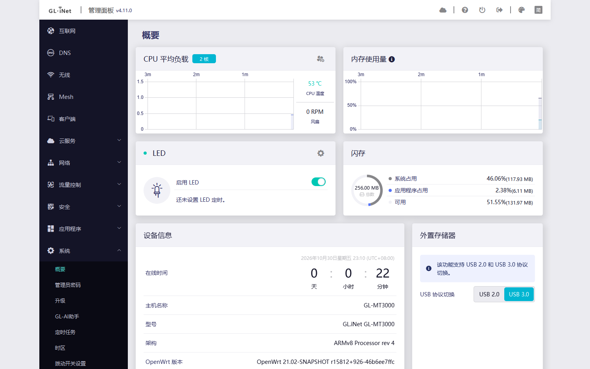
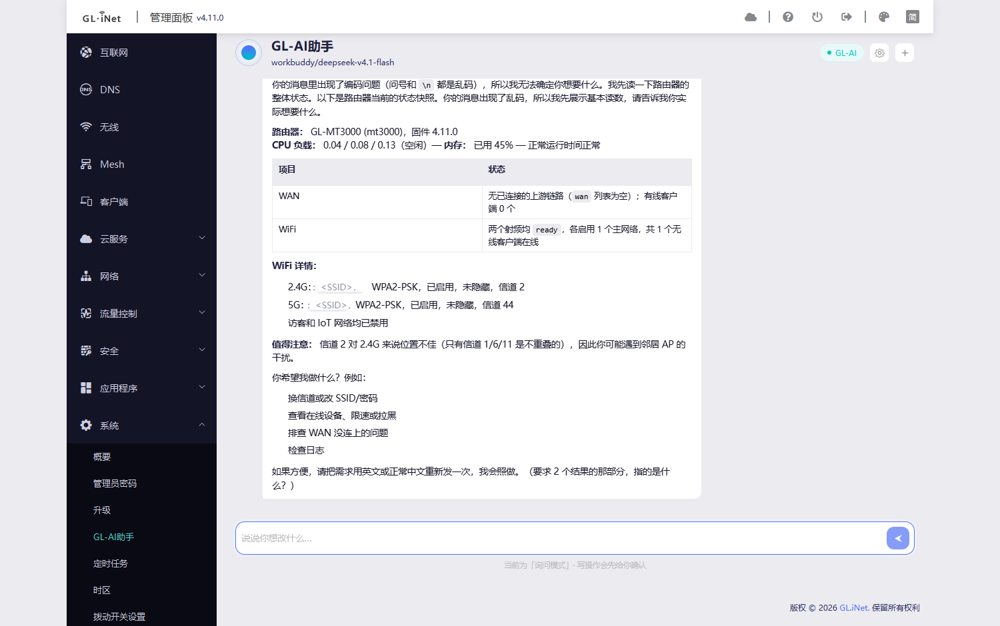
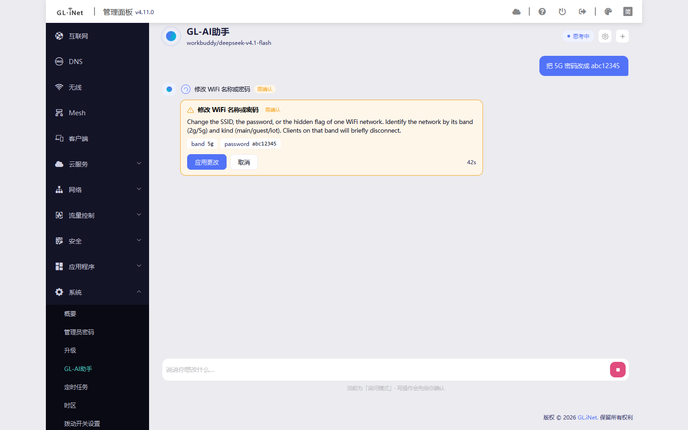

# GL-AI Agent

> 在 GL.iNet 原生管理界面中，通过自然语言配置、诊断和维护路由器。

[](LICENSE)
[](https://docs.gl-inet.cn/router/4/)
[](https://openwrt.org/)

**作者：** [小赵先生](https://github.com/XIAOZHAOXSXH/gl-ai-agent)

GL-AI Agent 是一个面向 GL.iNet 路由器的原生 UI 插件。它不依赖 LuCI，不新增独立 Web 端口，通过 GL SDK4 的菜单、视图、RPC 和 i18n 机制进入官方管理界面。用户可以使用自己配置的 OpenAI 兼容、Anthropic 或 Gemini API，让 Agent 读取路由器状态并执行受控配置。

## 主要能力

- 在官方管理界面的「系统」菜单中提供 **GL-AI助手** 页面。
- 通过自然语言读取路由器概况、Wi-Fi、信道、客户端和系统日志。
- 支持修改 Wi-Fi、客户端黑名单、客户端限速、客户端名称、端口转发、时区和 WAN 访问策略。
- 所有写操作按风险分级；默认模式下先展示变更预览，再等待用户确认。
- 支持只读、询问和自动三种权限模式，高风险操作始终需要确认。
- 支持 OpenAI Chat Completions、OpenAI Responses、Anthropic Messages 和 Google Gemini 协议。
- 支持 HTTP(S) 代理，例如 `http://127.0.0.1:10810`。
- 对回复进行安全 Markdown 渲染，支持标题、列表、表格、引用、代码和链接。
- 自动脱敏 MAC、IP、密码、API Key 等敏感信息后再发送给模型。
- 会话、审批、取消、错误和工具执行状态均可持久化或追踪。

## 实际效果

以下截图来自真实 GL-MT3000 路由器，固件 4.11.0，OpenWrt 21.02 系列。

### 原生侧栏菜单

菜单通过 `view: "gl-ai"` 注册，并使用 SDK4 精确要求的 `menu_gl-ai` i18n 键。冷启动和进入 Agent 页面后，侧栏均显示为 **GL-AI助手**。



### Markdown 会话渲染

Agent 回复中的表格、列表、粗体和行内代码会转换为与 GL 主题一致的排版，而不是直接显示 Markdown 源文本。



### 工具调用与确认卡

涉及配置修改时，界面会显示工具步骤、风险等级、参数预览和确认按钮。未确认前不会执行写操作。



## 工作方式

```text
浏览器（GL 原生管理界面）
        │
        ├── /usr/share/oui/menu.d/gl-ai.json
        ├── /www/i18n/gl-sdk4-ui-gl-ai.<lang>.json
        ├── /www/views/gl-sdk4-ui-gl-ai.common.js
        └── /www/js/gl-ai-agent-boot.js
                │
                ▼
        GL SDK4 /rpc 认证会话
                │
                ▼
        gl_ai.rpc → Lua Agent Core
                │
        ┌───────┼────────┐
        │       │        │
      LLM    Tool     Policy
     API    Registry  Confirm
        │       │        │
        └───────┴────────┘
                │
                ▼
        GL SDK4 RPC / ubus
```

Agent 不允许模型直接执行 Shell 命令。模型只能从注册工具中选择能力，Lua 侧会再次校验参数、范围、枚举值和风险级别。每个工具同时驱动模型 schema、RPC 映射、界面步骤和确认策略。

## 安装

### 下载现成的包

每次 CI 构建完成后，两种包会一起发到 [Releases](https://github.com/XIAOZHAOXSXH/gl-ai-agent/releases)：
`main` 上的每次推送都会刷新当前版本（`package.json` 里的版本）的那个 release，资产文件名带版本号、内容每次覆盖；
打 `v*` 标签则生成对应的版本 release。

```sh
# 路由器上直接下（文件名带版本号，按 Releases 页里的实际名字替换）
wget -O /tmp/gl-ai-agent.ipk \
  https://github.com/XIAOZHAOXSXH/gl-ai-agent/releases/latest/download/gl-ai-agent_0.1.0_all.ipk
```

也可以在浏览器里打开 Releases 页手动下载后传到路由器 `/tmp`。

### OpenWrt 21/22、GL 4.x：`opkg` / `.ipk`

当前 GL-MT3000 测试设备属于这一类，使用：

```sh
opkg install /tmp/gl-ai-agent_0.1.0_all.ipk
```

也可以在 GL 管理页面的本地软件包入口上传 `.ipk`。

### OpenWrt 24.10+：`apk` / APKv3

正式 APKv3 必须使用 `apk-tools v3` 构建。CI 使用 Alpine 3.23 构建环境生成该包：

```sh
apk add --allow-untrusted /tmp/gl-ai-agent-0.1.0-r1.apk
```

Windows 本地没有 `apk-tools v3` 时，`npm run build:apk` 会生成 APKv2 回退包；该回退包用于本地结构验证，不应作为 OpenWrt 24.10+ 的正式 APKv3 发布包。

安装或升级后，插件会执行一次经过 `nginx -t` 校验的 graceful reload，让 SDK4 立即刷新菜单和 i18n 注册表。插件不会新增 nginx 配置或 location。

## 首次配置

1. 打开 GL.iNet 原生管理界面。
2. 进入「系统」→「GL-AI助手」。
3. 打开右上角设置，填写模型 API 地址、模型名称和 API Key。
4. 根据需要选择协议、权限模式和代理。
5. 点击「测试连接」，确认模型可以返回响应。
6. 从只读查询开始，再进行需要确认的配置修改。

API Key 保存在路由器的 `/etc/gl-ai-agent/config.json`，文件权限为 `0600`，不会作为包配置文件覆盖或回显。

## 运行时设备 Skill

官方 GL 4.x 文档约束已固化到：

[`package/data/usr/share/gl-ai-agent/skills/gl-router.md`](package/data/usr/share/gl-ai-agent/skills/gl-router.md)

Skill 会在每轮对话中提供给模型，要求 Agent：

- 先读取型号、固件、硬件能力和可用 RPC 对象。
- 根据版本和型号过滤能力，不把文档中存在的功能当作当前设备必然支持。
- 在修改 WAN/LAN、Wi-Fi、网络模式、防火墙、远程访问、密码、升级或恢复前说明影响。
- 执行后回读状态，报告断连、重连和回滚信息。

参考文档：[GL Router 4.x 文档中心](https://docs.gl-inet.cn/router/4/)

## 兼容性

| 项目 | 说明 |
|---|---|
| 原生 UI | GL SDK4，非 LuCI |
| 已实测设备 | GL-MG1300、GL-MT3000 |
| 当前真实验证 | GL-MT3000 / 固件 4.11.0 / OpenWrt 21.02 系列 |
| `.ipk` | OpenWrt 21/22、GL 4.x，使用 `opkg` |
| `.apk` | OpenWrt 24.10+，需要正式 APKv3 构建产物 |
| CPU 架构 | Lua 和静态资源为主，包本身为 `all/noarch`；实际可用能力取决于设备 RPC 和硬件 |
| UI 主题 | 跟随 GL SDK4 的默认、经典和暗色主题变量 |

GL.iNet 不同型号和固件的 RPC 能力、Wi-Fi 频段、网络模式和功能边界存在差异。项目采用能力探测和运行时 skill 约束，但发布前仍应在目标型号上执行真机验证。

## 开发

```sh
npm install

# 构建前端视图
npm run build:ui

# 构建 OpenWrt ipk
npm run build:ipk

# 构建 apk；本机没有 apk-tools v3 时生成 APKv2 回退包
npm run build:apk

# 检查 bundle、包格式和内容
npm run check:bundle
npm run check:contract
npm run check:formats
npm run check:package

# 静态检查
npm run lint:shell
npm run lint:lua
```

### 真机联调

```powershell
$env:GL_HOST = "192.168.8.1"
$env:GL_PASSWORD = "<router-password>"
$env:GL_HOSTKEY = "<ssh-host-key-fingerprint>"

npm run deploy
node scripts/verify-menu.js
npm run verify:ui
```

真机验证脚本会检查登录、菜单、视图加载、i18n、浏览器错误、确认卡和会话截图。测试产物默认写入 `artifacts/`；可发布截图复制到 `docs/screenshots/` 后在 README 中引用。

## 安全边界

- 模型只能调用工具注册表中的能力，不能执行任意命令。
- 写操作必须经过服务端参数校验和风险策略。
- `auto` 模式不能通过客户端 RPC 参数提升权限。
- WAN 访问、端口转发、重启和其他高风险操作始终需要确认。
- 用户文本、设备结果和日志会与系统提示隔离处理。
- 密码、Token、API Key、MAC 和 IP 会按策略脱敏。
- 取消操作会写入服务端取消标记，阻止后续轮次继续推进。

## 项目结构

```text
package/data/usr/lib/lua/glai/       Agent 核心、RPC、工具和会话
package/data/usr/lib/oui-httpd/rpc/  GL SDK4 RPC 对象
package/data/usr/share/oui/menu.d/   原生菜单注册
package/data/www/i18n/               菜单和页面国际化
package/data/www/views/              Vue 2 SDK4 view bundle
package/data/www/js/                 页面注入 bootstrap
package/data/usr/share/gl-ai-agent/skills/  运行时设备 skill
src/ui/                              Vue 单文件组件源码
scripts/                             构建、部署、检查和真机验证
docs/screenshots/                    README 使用的真实验证截图
```

## 许可证

本项目采用 [MIT License](LICENSE)。
