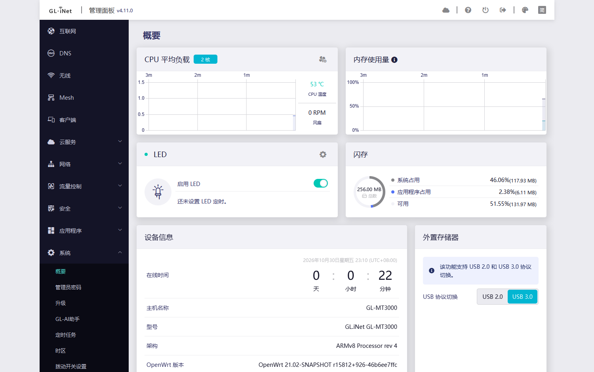
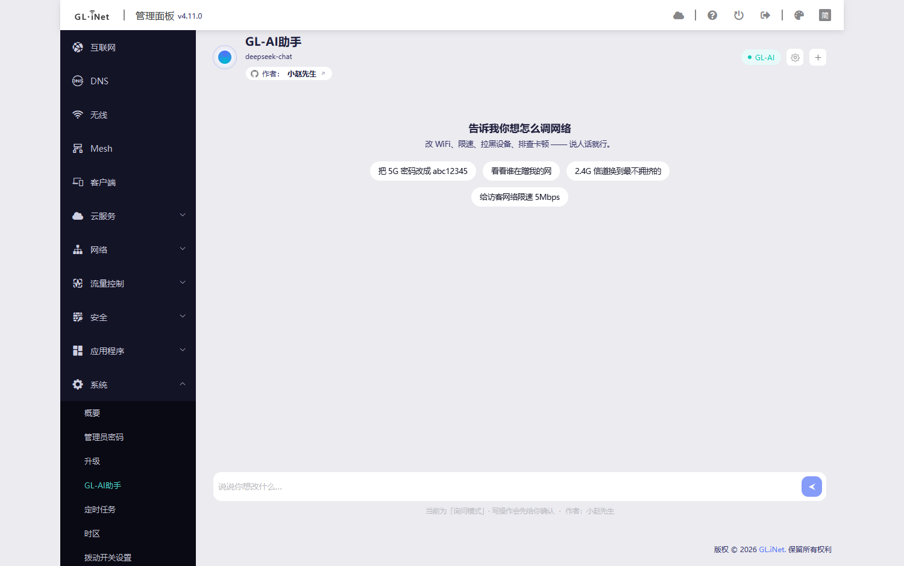
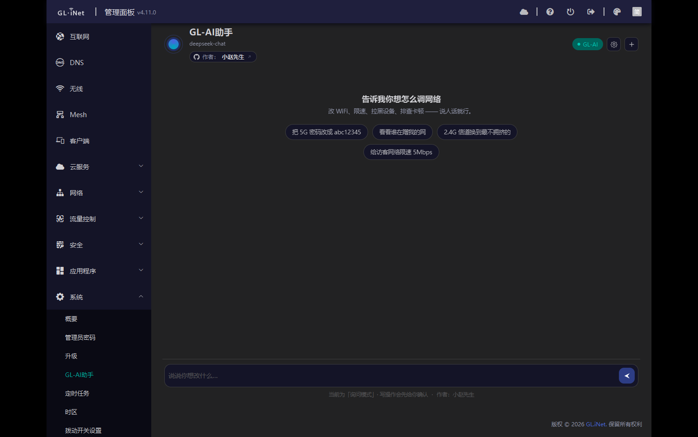
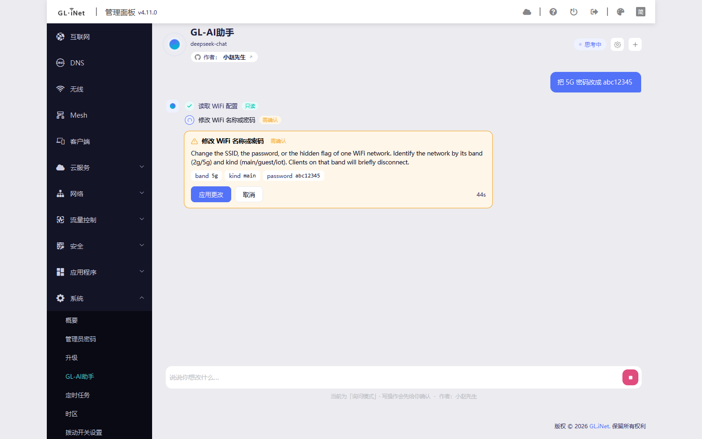
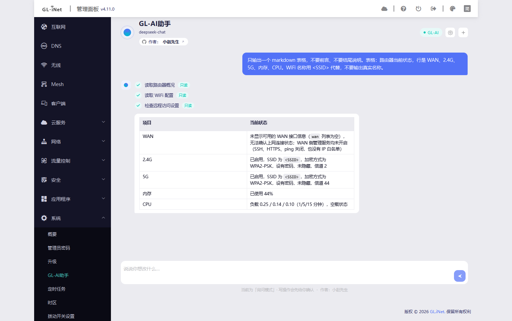
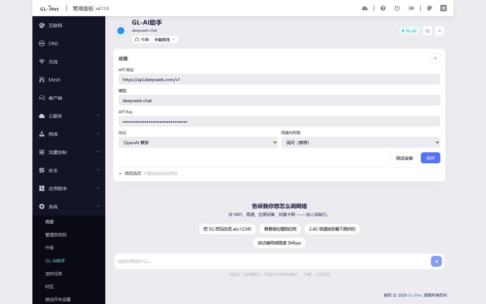

# 【原创】GL-AI助手：给 GL.iNet 原生后台加一个 AI 配置助手（开源 · 不改 LuCI · 适配 GL 全系 4.x）

折腾 GL.iNet 的应该都有同感：这台机器功能其实很全，但路径深——改个 WiFi 密码要点「无线 → 5G → 密码 → 保存」，
查谁在蹭网要翻客户端页，限速要进流量控制，排查卡顿还得挨个看状态。

所以我写了个东西：**在 GL 原生后台里加一个「GL-AI助手」页，说人话就能改配置**。
不是把 LuCI 搬过来，也不是另开一个页面，而是真的注入到 GL 自己的界面里。全部开源。


*图1：装完之后，原生侧边栏「系统」分组下多了一项「GL-AI助手」，右键菜单、面包屑、主题都跟原版一致*

---

## 一、它能干什么

一句话：**把「点五六层菜单」换成「说一句」**。

- 「把 5G 密码改成 abc12345」
- 「看看谁在蹭我的网」
- 「2.4G 信道换到最不拥挤的」
- 「给访客网络限速 5Mbps」
- 「WAN 为什么没连上，帮我查一下」

模型不会直接改配置：它先把需求翻译成一次**工具调用**（读状态或写配置），路由器侧再校验参数、
判断风险等级，写操作一律先弹确认卡，你点了「应用更改」才真正执行。


*图2：对话首页，下面那排是快捷提问，点一下直接发出*

---

## 二、为什么说是「注入原生界面」而不是外挂

这点是我最在意的，也是它比「套个 iframe 的 AI 页面」好用得多的原因：

1. **菜单是同源的**：走 GL 自己的 `/usr/share/oui/menu.d/*.json` 机制，所以出现在原生侧边栏里，
   自带原生的图标、高亮态、折叠行为（图1）。
2. **样式是同源的**：颜色全部走 GL 的 design token（`--primary`、`--background-card`、`--divider`…），
   所以后台切 default / dark / classic 三种主题，插件跟着变，不用改一行代码（图6）。
3. **文案是同源的**：走 `/www/i18n/` 的命名空间，跟随后台语言切换，简繁英日德西意七种。
4. **对系统是零侵入的**：**不新增任何 nginx 配置、不改 location、不重启服务**。
   装完只是做一次 `nginx -t` 校验过的 graceful reload，让 SDK4 刷新菜单和 i18n 注册表。
   卸载时把注入的那一个 `<script>` 摘掉，页面回到装之前的样子。


*图6：暗色主题，颜色全部来自原生令牌，不需要额外适配*

---

## 三、安全这块我是怎么想的

大模型控制路由器听起来就吓人，所以设计上做了几层限制：

**1. 模型没有 shell。**
它不能执行命令、不能读写文件，只能从 15 个注册工具里挑一个。Lua 侧还会再校验一遍参数类型、
枚举值、范围、风险等级——模型说错话也不会变成非法配置。

**2. 写操作必须过确认闸门。**
每一笔写操作都会弹一张卡：改什么、参数是什么、会造成什么影响（比如「该频段客户端会短暂断连」），
还有一个倒计时。**不点就不执行**，倒计时结束自动取消。


*图3：让它改 5G 密码。它先读了 WiFi 配置（绿色「只读」），然后停下来弹确认卡，参数、影响、倒计时都在上面*

**3. 实测：不确认 = 真的没写。**
上图那个卡片我没有点。倒计时走完后去路由器上查 `uci show wireless`，
搜不到新密码 —— 说明确实没有发生任何写入。这一点比任何文字承诺都有说服力。

**4. 三档权限。**
`只读`（只查不改）/ `询问`（默认，写操作要确认）/ `自动`（常规操作直接执行，但改密码、改 LAN、
开端口、重启这类高危操作仍然要确认）。

**5. 每一步都留痕。**
每次工具调用（工具名、参数、结果）都会作为一条步骤留在这次会话里，事后能翻回去看它到底读/写了什么，
不是"黑箱改完就没了"。

**6. 失败会明说。**
工具报错会直接显示成失败步骤，不会用"已修改"糊弄过去。密码、LAN 地址、远程访问、
固件/重启、任何扩大 WAN 暴露面的改动，即使开了自动模式也要确认。密码、LAN 地址、远程访问、
固件/重启、任何扩大 WAN 暴露面的改动，即使开了自动模式也要确认。

---

## 四、回复渲染

模型回复支持 Markdown：表格、行内代码、列表都能正常渲染，长结果比纯文本好读很多。


*图4：让它汇报一次路由器状态，表格和行内代码都渲染出来了（WiFi 名称已打码）*

---

## 五、技术实现（给想抄作业的）

有兴趣的自己看仓库，这里只挑几个坑：

- **前端**：GL 后台是 Vue 2 runtime-only 的 SPA，页面里**没有** `module / exports / require / Vue` 全局。
  视图是 `component = eval(await axios.get('/views/gl-sdk4-ui-<view>.common.js'))` 拿到的，
  所以 bundle 的 eval 返回值**必须就是组件对象**——用 webpack 的 `library` 包裹会返回一个 Module 包装，
  结果就是页面挂载成空白。这个我踩过。
- **后端**：跑在 nginx 的 Lua 里，不额外起守护进程（路由器内存本来就紧）。
  注意 `/rpc` 的 `oui.rpc` 会把方法表缓存在 worker 里——加个方法不重启 nginx 就不生效。
  所以 RPC 对象只暴露一个永不变化的 `rpc` 方法，内部再 `loadfile` 真实实现，这样升级不用重启。
- **Agent 循环**：不能用 `ngx.timer`（定时器上下文禁用子请求，`clients.get_list` 会直接报
  `API disabled in the current context`），也不能用 `pcall` 包住会 yield 的调用（Lua 5.1 直接报
  `attempt to yield across metamethod/C-call boundary`）。
  最后做成**协作式分步**：前端每次 poll 推进一步，一个工作单元一次。
- **工具注册表是单一事实源**：同一个 Lua 表同时驱动模型看到的 schema、RPC 映射、界面步骤、确认策略和风险等级。
  加工具只改一处。

---

## 六、兼容性

| 系统 / 设备 | 包格式 | 状态 |
|---|---|---|
| GL 固件 4.11.0（GL-MT3000） | `.ipk` | 实测通过 |
| GL 固件 4.10.1（GL-MG1300） | `.ipk` | 实测通过 |
| OpenWrt 21.02 / 22.03 | `.ipk` | 包结构校验通过 |
| OpenWrt 24.10+ / 25.x | `.apk`（APKv3） | CI 用 apk-tools v3 构建，装机校验通过 |

- 安装包 75 KB 左右，解开约 230 KB，没有额外常驻进程，内存占用基本就是 nginx 已有的 Lua 运行时。
- 不同型号支持的项不一样：工具会先探测硬件能力（有没有 MODE 键、几个网口、有没有访客网络），
  不支持的功能会直接告诉你，不会假装成功。

---

## 七、安装

到 Releases 页面下载对应的包（每次 CI 构建都会自动发版，两个格式在一起）：

<https://github.com/XIAOZHAOXSXH/gl-ai-agent/releases>

**GL 固件 4.x / OpenWrt 21–22（opkg）**

```sh
opkg install gl-ai-agent_0.1.0_all.ipk
```

**OpenWrt 24.10+ / 25.x（apk）**

```sh
apk add --allow-untrusted gl-ai-agent-0.1.0-r1.apk
```

装好后打开管理面板，在 **系统 → GL-AI助手**，第一次进去点右上角齿轮填模型 API：


*图5：设置面板。API 地址填 OpenAI 兼容的 `/v1`，也支持 Anthropic、Gemini 协议*

- 协议支持 **OpenAI 兼容 / Anthropic / Gemini** 三种，自定义 `base_url`（中转、自建都行）
- 有个「代理」选项，模型 API 需要走代理时填
- **证书校验可以关**：校园网、酒店网络、某些中转会用自己的证书，不关连不上（默认开，自己判断风险）
- **模型要选支持 function calling 的**，纯对话模型用不了工具

---

## 八、已知限制（别抱不切实际的期待）

- 版本还在 **0.1.0**，早期阶段，欢迎报 bug。
- **体验上限取决于模型**。同一个需求，强模型一次就过，弱模型会绕圈；建议至少用带工具调用的中等以上模型。
- 会话历史界面还没做（后端接口已经有了，UI 下个版本）。
- 部分功能目前只做了单向：端口转发只能新增（还不会读/改/删），DDNS、家长控制这些没纳入。
- 目前只在两台机器上实测（MT3000 / MG1300），其它型号需要你们帮忙验证。

---

## 九、路线图 & 求测试

- [x] 原生界面注入 + 三主题跟随
- [x] 确认闸门 / 三档权限 / 步骤留痕
- [x] opkg + apk 双格式打包，CI 自动发版
- [ ] 会话历史 UI
- [ ] 更多工具（端口转发的读/改/删、DDNS、家长控制、系统日志分析）
- [ ] 更省内存的上下文裁剪（给 128MB 以内的机器）

**如果你愿意帮忙测试**，回帖带这三样我就能定位：型号、GL 固件版本、出问题的原话 + 截图。
有 RPC 报错的话，`logread | grep -i glai` 的输出也很有用。

---

## 十、开源

- 仓库：<https://github.com/XIAOZHAOXSXH/gl-ai-agent>
- 作者：小赵先生
- License：MIT，随便改，欢迎 PR

> 说明：个人开源项目，**非 GL.iNet 官方**，与官方无关；会修改路由器配置，请自行评估风险。
> 插件不新增 nginx 配置、不改系统服务，卸载可完全恢复后台原貌。
