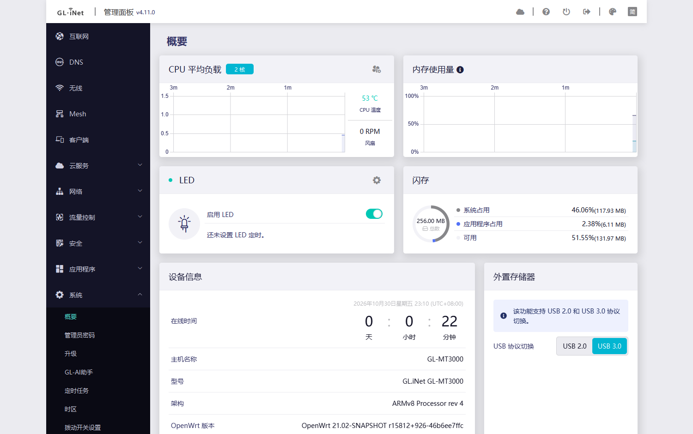
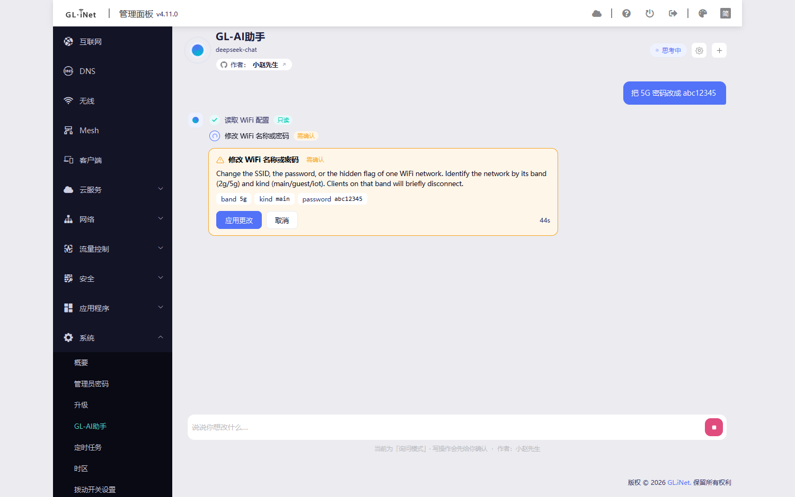
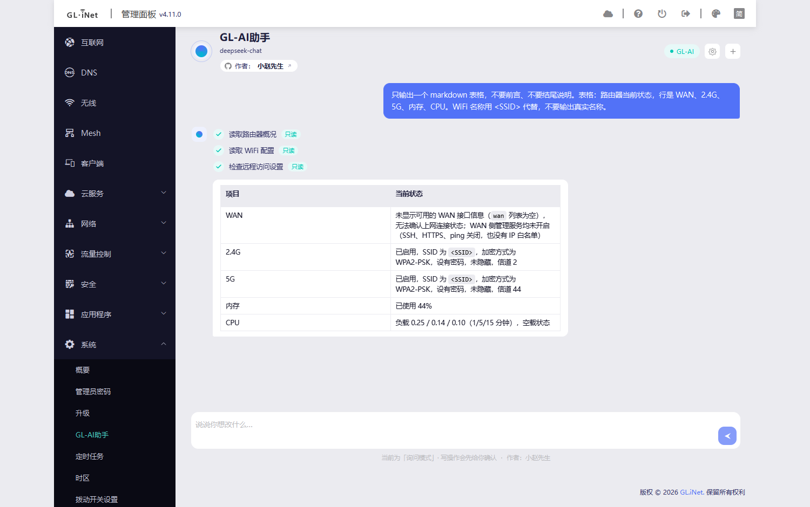

Configure the router by typing what you want - small open source plugin for the stock panel

I like GL's admin panel, but changing one thing usually means walking down three or four
nested pages: Wireless -> 5G -> password -> Save. After doing that for the tenth time I
wrote a plugin that adds one page to the stock panel, where you just type the sentence.

It is not an overlay. The page registers through menu.d, colours come only from the SDK4
design tokens so it follows the default / dark / classic themes, and strings go through
/www/i18n. The package adds no nginx config: installing ends with a config check and
a graceful reload, and uninstalling removes the injected script tag, leaving the panel as
it was.

The part I spent the most time on is being boring about writes. The model has no shell - it
cannot run commands or touch files, it can only pick one of 15 registered tools, and the Lua
side re-validates type, enum, range and risk afterwards. Every write stops at a confirmation
card with the tool name, the exact arguments, the expected impact ("clients on that band will
briefly disconnect") and a countdown.

I tested the boring case: left the card alone, let the countdown expire, then ran
`uci show wireless` and there was no trace of the new password. Reads run straight through,
and every tool call stays in the conversation as a step you can scroll back to.

Replies are rendered as markdown, which matters more than I expected for status reports:

Tested on GL-MT3000 (firmware 4.11.0) and GL-MG1300 (4.10.1). Both package formats are built
and published from CI:

    https://github.com/XIAOZHAOXSXH/gl-ai-agent/releases

    opkg install gl-ai-agent_0.1.0_all.ipk                # GL 4.x / OpenWrt 21-22
    apk add --allow-untrusted gl-ai-agent-0.1.0-r1.apk    # OpenWrt 24.10+

Then System -> GL-AI助手, gear icon, and fill in the model endpoint: OpenAI-compatible,
Anthropic or Gemini, custom base_url, optional proxy. TLS verification can be turned off
(some networks and relays present their own certificate) and the model needs function
calling - plain chat models cannot drive the tools.

Caveats, because this is 0.1.0. Session history UI does not exist yet, port forwarding can
only add rules, no DDNS or parental controls. The experience depends heavily on the model:
a good one goes straight to the right tool, a weak one circles. Only two devices tested so
far.

Two things that cost me time, in case someone is writing something similar: the view bundle
has to eval to the component object itself (wrapping it in a webpack `library` mounts an
empty page), and `oui.rpc` caches an object's method table per worker, so adding methods the
usual way needs an nginx restart - this RPC object exposes a single `rpc` method and
dispatches inside it instead.

Repo and release notes: https://github.com/XIAOZHAOXSXH/gl-ai-agent (MIT). Unofficial, not
affiliated with GL.iNet, and it does change router settings.

Feedback welcome, including "does not work on model X". If something fails, model +
firmware + the exact sentence you used is enough for me to reproduce it, and
`logread | grep -i glai` helps when a call errors out.
